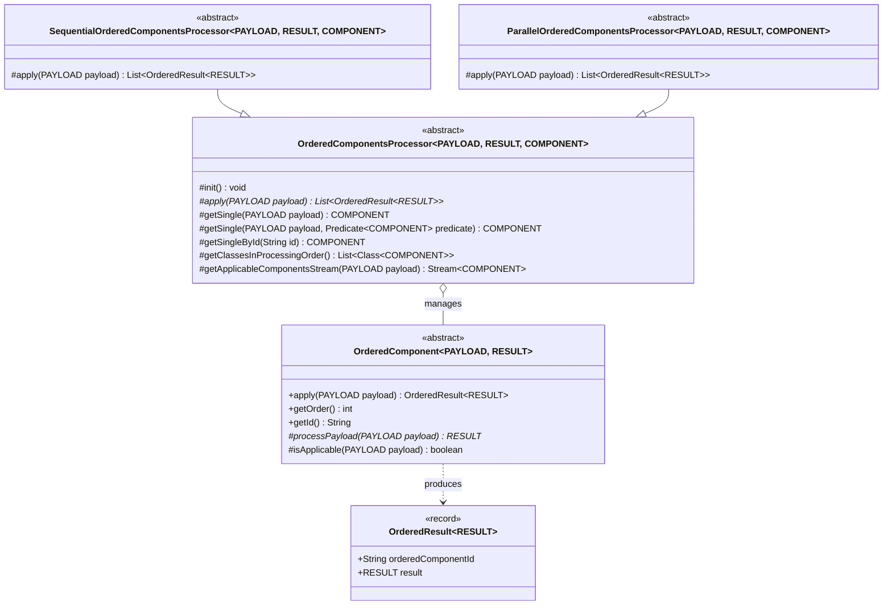

# ordered-spring-boot-starter

A lightweight Spring Boot starter providing generic, type-safe abstractions for building ordered processing pipelines and strategy resolvers (**Chain of Responsibility** and **Strategy** patterns).

---

## Features

- **Deterministic Component Ordering**: Automatically orders discovered Spring beans using Spring's `Ordered` / `@Order` precedence (via `AnnotationAwareOrderComparator`) or an explicit class-based execution sequence.
- **Conditional Execution**: Filters pipeline steps dynamically at runtime via `isApplicable(payload)`.
- **Dual Execution Strategies**:
  - **Sequential**: Synchronous, in-order stream execution (`SequentialOrderedComponentsProcessor`).
  - **Parallel**: High-throughput concurrent execution powered by **Java Virtual Threads** (`ParallelOrderedComponentsProcessor`) while preserving deterministic result ordering.
- **Result Provenance**: Wraps every component output in an immutable `OrderedResult<RESULT>` record paired with the originating component ID.
- **Proxy-Resilient Identification**: Resolves component IDs and target classes safely through Spring AOP / CGLIB proxies using `AopProxyUtils.ultimateTargetClass(...)`.
- **Single-Strategy Lookup**: Built-in helper methods (`getSingle`, `getSingleById`) to resolve exactly one applicable strategy or retrieve a component by its ID.

---

## Requirements & Tech Stack

- **Java**: 25+
- **Spring Boot**: 4.1.1+ (Spring Framework 7+)
- **Dependencies**:
  - `com.pavelshapel:common-api-spring-boot-starter`
  - `org.springframework.boot:spring-boot-starter`

---

## Installation

Add the dependency to your `pom.xml`:

```xml
<dependency>
  <groupId>com.pavelshapel</groupId>
  <artifactId>ordered-spring-boot-starter</artifactId>
  <version>1.0.0</version>
</dependency>
```

The starter auto-configures itself automatically via Spring Boot's `AutoConfiguration.imports`.

---

## Architecture & Core Abstractions



### Core Types

| Type | Visibility | Description |
| :--- | :--- | :--- |
| `OrderedResult<RESULT>` | `public record` | Immutable carrier holding `orderedComponentId` and the `result` returned by the component. |
| `OrderedComponent<PAYLOAD, RESULT>` | `public abstract` | Base component implementing `Function<PAYLOAD, OrderedResult<RESULT>>` and Spring's `Ordered`. |
| `OrderedComponentsProcessor<P, R, C>` | `package-private abstract` | Base orchestrator that validates ID uniqueness, orders injected components at `@PostConstruct`, and provides lookup methods. |
| `SequentialOrderedComponentsProcessor<P, R, C>` | `public abstract` | Executes all applicable components sequentially in their configured order. |
| `ParallelOrderedComponentsProcessor<P, R, C>` | `public abstract` | Executes all applicable components concurrently using `Executors.newVirtualThreadPerTaskExecutor()` and collects results in deterministic order. |

---

## Usage Guide

### 1. Define a Domain Component Hierarchy

Create a domain-specific base component extending `OrderedComponent<PAYLOAD, RESULT>` and implement concrete steps as Spring beans:

```java
package com.example.order;

import com.pavelshapel.starter.boot.spring.ordered.OrderedComponent;
import org.springframework.stereotype.Component;

public record OrderContext(String orderId, double amount, boolean international) {}

public abstract class OrderValidationStep extends OrderedComponent<OrderContext, Boolean> {}

@Component
public class AmountValidationStep extends OrderValidationStep {

  @Override
  public int getOrder() {
    return 10;
  }

  @Override
  protected Boolean processPayload(OrderContext payload) {
    return payload.amount() > 0;
  }
}

@Component
public class CustomsValidationStep extends OrderValidationStep {

  @Override
  public int getOrder() {
    return 20;
  }

  @Override
  protected boolean isApplicable(OrderContext payload) {
    return payload.international();
  }

  @Override
  protected Boolean processPayload(OrderContext payload) {
    // Perform customs check for international orders
    return true;
  }
}
```

### 2. Create a Sequential or Parallel Processor

#### Option A: Sequential Execution

Extend `SequentialOrderedComponentsProcessor` when steps must execute synchronously one after another:

```java
package com.example.order;

import com.pavelshapel.starter.boot.spring.ordered.OrderedResult;
import com.pavelshapel.starter.boot.spring.ordered.SequentialOrderedComponentsProcessor;
import java.util.List;
import org.springframework.stereotype.Service;

@Service
public class SequentialOrderValidator
    extends SequentialOrderedComponentsProcessor<OrderContext, Boolean, OrderValidationStep> {

  public SequentialOrderValidator(List<OrderValidationStep> components) {
    super(components);
  }

  public List<OrderedResult<Boolean>> validate(OrderContext context) {
    return apply(context);
  }
}
```

#### Option B: Parallel Execution with Virtual Threads

Extend `ParallelOrderedComponentsProcessor` when steps are independent (e.g., I/O-bound enrichment or external API calls) and can run concurrently on Java Virtual Threads:

```java
package com.example.order;

import com.pavelshapel.starter.boot.spring.ordered.OrderedResult;
import com.pavelshapel.starter.boot.spring.ordered.ParallelOrderedComponentsProcessor;
import java.util.List;
import org.springframework.stereotype.Service;

@Service
public class ParallelOrderValidator
    extends ParallelOrderedComponentsProcessor<OrderContext, Boolean, OrderValidationStep> {

  public ParallelOrderValidator(List<OrderValidationStep> components) {
    super(components);
  }

  public List<OrderedResult<Boolean>> validateConcurrently(OrderContext context) {
    return apply(context);
  }
}
```

> [!NOTE]
> Even though `ParallelOrderedComponentsProcessor` executes tasks concurrently across Virtual Threads, the returned `List<OrderedResult<RESULT>>` preserves the deterministic component order defined by the processor.

### 3. Explicit Class-Based Ordering (Optional)

Instead of relying on `getOrder()` or `@Order`, a processor can explicitly define the exact sequence of component classes (and filter out any unlisted components) by overriding `getClassesInProcessingOrder()`:

```java
@Override
protected List<Class<? extends OrderValidationStep>> getClassesInProcessingOrder() {
  return List.of(
      AmountValidationStep.class,
      CustomsValidationStep.class
  );
}
```

### 4. Strategy Resolution (`getSingle` & `getSingleById`)

You can also use the processor as a **Strategy Resolver** when exactly one component should handle a given payload or be looked up by its ID:

```java
public OrderValidationStep resolveSingleStep(OrderContext context) {
  // Throws if zero or more than one component is applicable
  return getSingle(context);
}

public OrderValidationStep resolveById(String stepId) {
  // Throws NoSuchElementException if no component with stepId exists
  return getSingleById(stepId);
}
```

---

## Initialization & Validation Contracts

During `@PostConstruct` (`init()`):
1. `getClassesInProcessingOrder()` determines the target execution sequence.
2. Injected components whose ultimate target class is present in the processing order list are sorted accordingly.
3. Components are indexed by `getId()` (defaults to `getTargetClass().getSimpleName()`).
4. If two components resolve to the same ID, initialization fails fast with an `IllegalStateException` (`Duplicate component id found: [...]`).

---

## Building & Running Tests

Run unit tests via Maven:

```bash
mvn clean test
```

Build and install the artifact locally:

```bash
mvn clean install
```
